# TakeLab

**Your script, demos and cameras. One recording workspace.**

TakeLab is a local browser studio for technical creators. Keep your script near the camera while you explain code, demonstrate an app and record your screen with up to three cameras.

[](https://github.com/schogini/takelab/actions/workflows/ci.yml)
[](LICENSE)

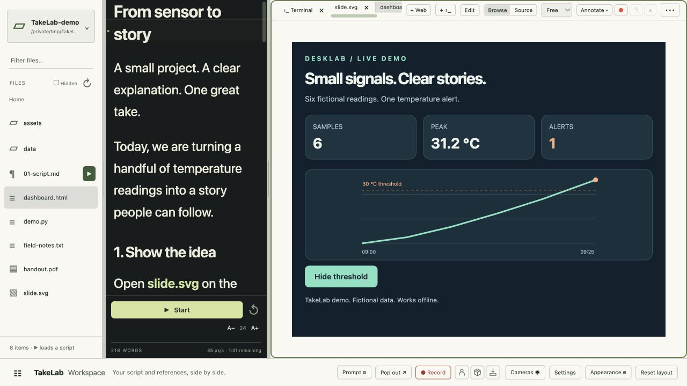

[Quick start](#quick-start) · [Try the demo](#try-the-included-demo) · [Screens and settings](#screens-and-settings) · [Recording and downloads](#recording-and-downloads) · [Full manual](docs/USER_GUIDE.md)

## Quick start

You need **macOS, Python 3.10+ and desktop Chrome**. The core app needs no pip packages, npm install or build step.

```bash
git clone https://github.com/schogini/takelab.git
cd takelab
./takelab ./demo
```

The browser opens automatically. In the file list, click **▶ beside `01-script.md`** to load the teleprompter, then click **`slide.svg`** to open your first reference.

To work in your own folder:

```bash
/path/to/takelab/takelab /path/to/your/project
```

Omit the folder argument to use your terminal's current folder. Stop TakeLab with **Ctrl+C** in the terminal that launched it.

| Option | When to use it |
| --- | --- |
| `--no-open` | Print the address without opening a browser. |
| `--port 8766` | Keep a stable address for saved settings and recordings. |
| `--port 0` | Find an available port if the default is busy. |

Saved settings and recordings belong to the **same browser profile and local address, including port**. Use a stable port for everyday recording.

## Find your way around

| Area | What you do here |
| --- | --- |
| File list | Open a folder, filter files and choose references. **▶** beside a Markdown file loads it into the teleprompter. |
| Teleprompter | Read your script while the reference changes independently. Drag its right divider to make it narrower or wider. |
| Browse area | Switch between file, terminal and URL tabs. Choose an aspect ratio for your recording frame. |
| Workspace bar | Open **Prompt**, **Pop out**, **Record**, **Cameras**, **Settings** and **Appearance**. In the screenshots this bar is at the bottom. |

The screenshots use the included fictional demo. Camera feeds are off, and no personal recordings or physical devices were used to create them.

## Try the included demo

The [demo folder](demo) is a complete offline presentation kit about a small sensor project. It needs no hardware, API keys, account or extra Python packages.

| File | Try this |
| --- | --- |
| [01-script.md](demo/01-script.md) | Click its **▶** button for a ready-to-read narration. Clicking the filename opens formatted Markdown on the right. |
| [slide.svg](demo/slide.svg) | Open a 16:9 visual explaining the project in three steps. |
| [demo.py](demo/demo.py) | Preview the highlighted Python code, then run it in a terminal. |
| [data/readings.csv](demo/data/readings.csv) | Inspect the six invented temperature/humidity readings used by Python. |
| [dashboard.html](demo/dashboard.html) | Choose **Browse**, then click **Show threshold**. Switch to **Source** to explain the HTML. Styles and JavaScript are local in `demo/assets/`. |
| [handout.pdf](demo/handout.pdf) | Try page controls, zoom and annotations on a matching one-page handout. |
| [field-notes.txt](demo/field-notes.txt) | Click **Edit**, make a note and try **Save ⌘S** or **Cancel**. Saving changes the actual file. |

### 1. Read and show the idea

Load **`01-script.md`** with its **▶** button, open **`slide.svg`**, and select **16:9** above the browse area. Your script stays put as you change references.

Open **Prompt** to adjust text size and scroll speed. Press **Space** in the reading area to start or pause; after scrolling manually, click the script once to resume. Select **Pop out** for a compact reading window near your camera.

<details>
<summary>See reading settings and the floating teleprompter</summary>

**Prompt → reading settings:** text size, speed, line spacing, reading width, countdown, mirror and theme. Scroll within the settings panel to reach the remaining controls.

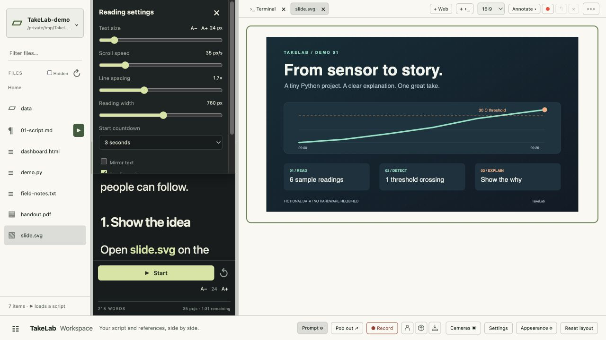

**Pop out:** controls stay at the bottom. **W− / W+** adjust width, **Speed − / Speed +** change scrolling, and **Top ↑** requests the screen's top usable edge. Browser and OS policies still control window chrome and placement.

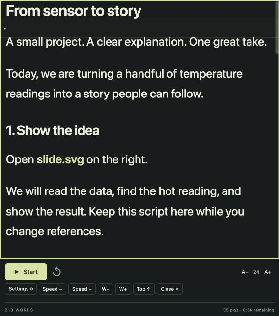

</details>

### 2. Explain the code and run it

Click **`demo.py`** to preview it. Select **Terminal**, then run these commands one at a time inside the demo folder:

```bash
python3 demo.py
python3 demo.py --limit 28
python3 demo.py --json
```

The first run reports **6 samples**, a **26.5 C average**, a **31.2 C peak** and **1 alert** above 30 C. Lowering the limit to 28 produces **2 alerts**. The JSON option is useful when explaining structured output.

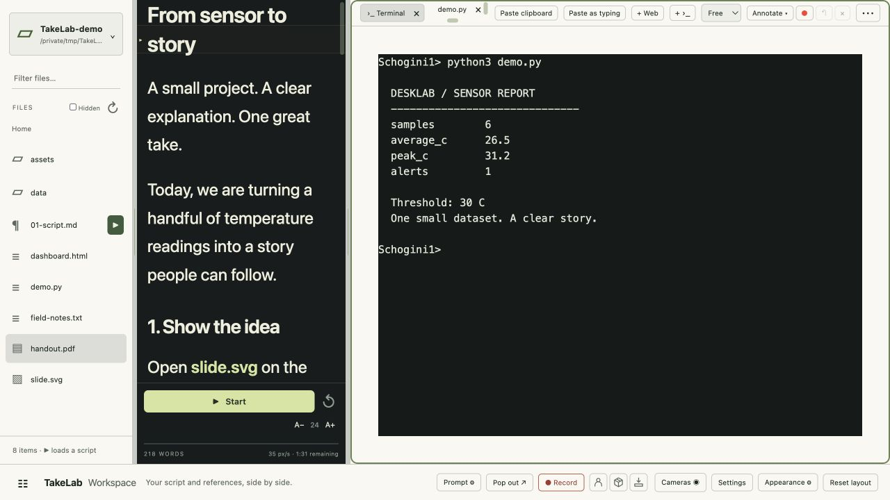

Use **+ ›_** for another terminal and **×** to close one. Each terminal starts in the currently browsed folder. **Paste clipboard** types clipboard text directly; **Paste as typing** lets you choose the speed and review the text first. The final Enter is yours unless you enable Enter between lines.

<details>
<summary>See code preview, typing controls and terminal actions</summary>

**Code preview:** open Python and other text/script files as independent tabs.

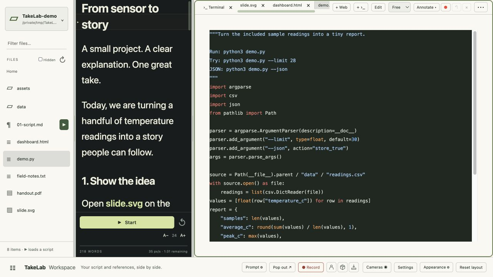

**Paste as typing:** preview the command, select a pace and click **Start typing**. Use the direct **Paste clipboard** button during a take to avoid opening this panel.

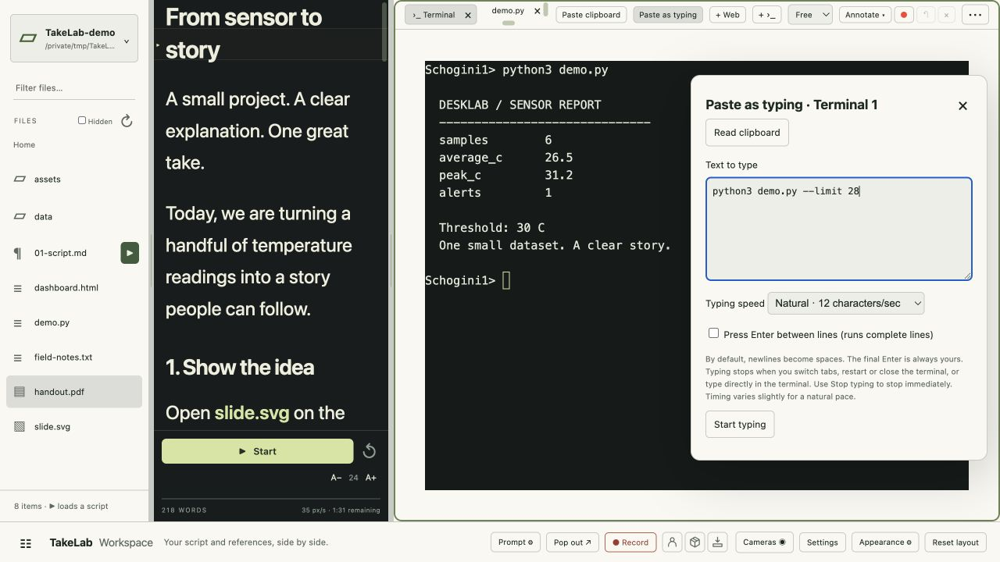

**⋯ → terminal actions:** restart in the current folder, end the shell, clear scrollback or adjust terminal text size.

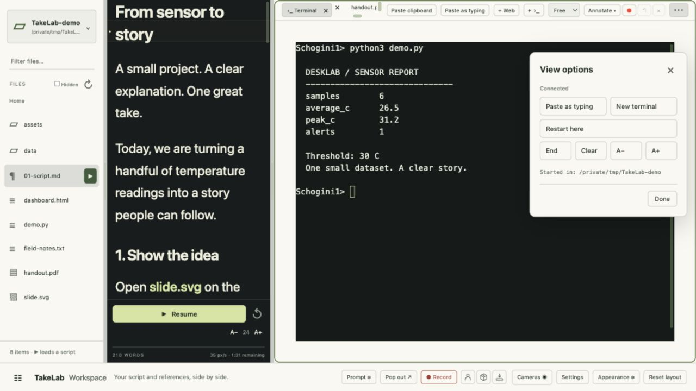

</details>

### 3. Demonstrate a page, file or PDF

Open **`dashboard.html` → Browse** and click **Show threshold**. This is a small interactive page using a fixed copy of the fictional dataset; editing the CSV changes the Python report, while the dashboard stays an independent HTML example.

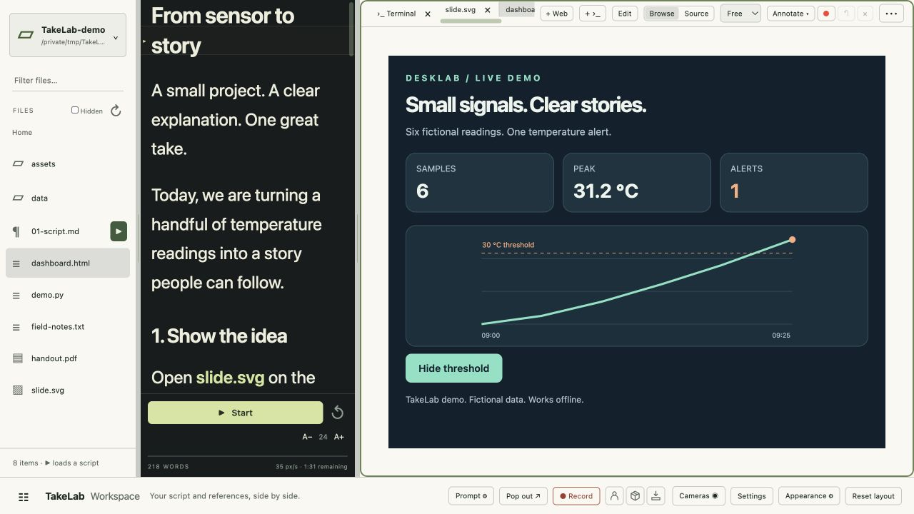

Use **Free** aspect ratio for more room with scrollable content. Use **16:9**, **9:16** or another ratio when preparing a specific recording frame.

<details>
<summary>See HTML source, Markdown, text editing, PDF and file actions</summary>

**HTML → Source:** inspect highlighted HTML without leaving the browse area. Switch back with **Browse**.

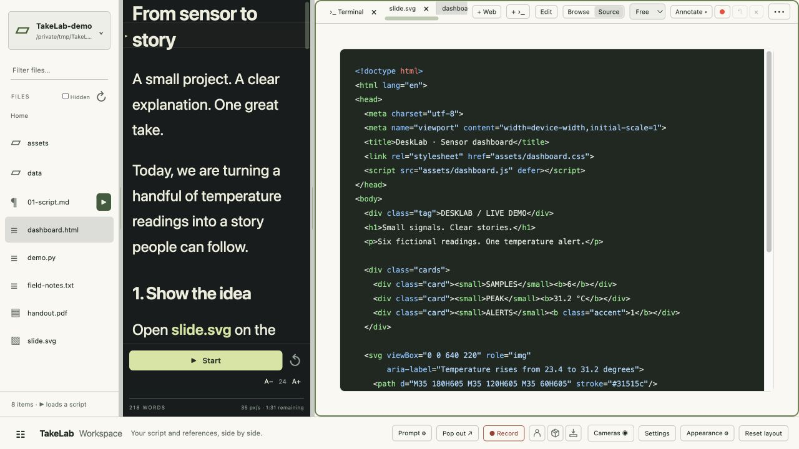

**Markdown:** click `01-script.md` itself to preview headings, paragraphs and code. Its **▶** button separately selects the teleprompter script.

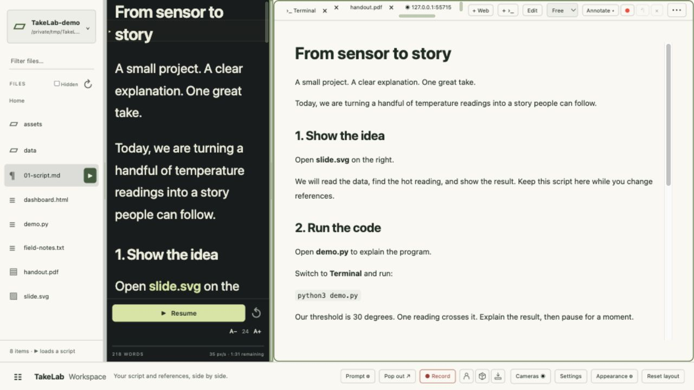

**Text editing:** open `field-notes.txt` and click **Edit**. **Save ⌘S** writes the original local file; **Cancel** leaves the editor. The same editor supports text, HTML, Python and other script files.

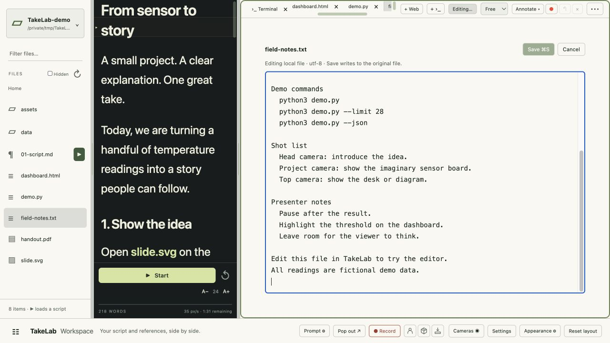

**PDF:** open `handout.pdf`. Use the page number, previous/next buttons, zoom or download control. This sample has one page.

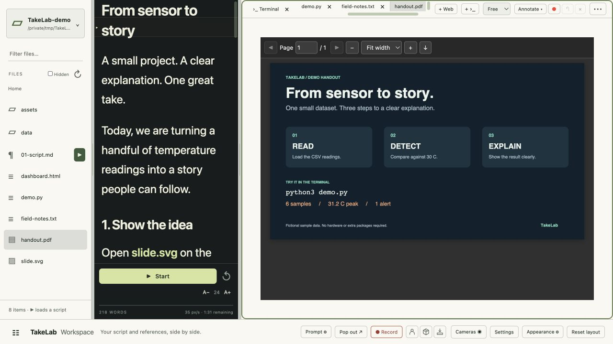

**⋯ → file actions:** download, inspect file details or send a Markdown file to the teleprompter.

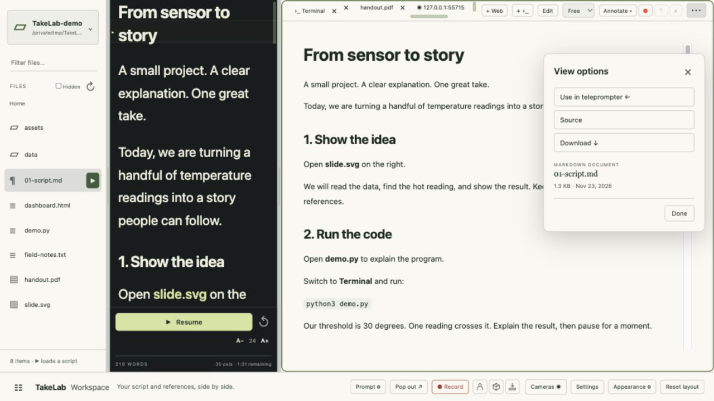

</details>

<details>
<summary>See URL tabs, refresh and Streamlit app mode</summary>

Choose **+ Web**, enter an address and click **Go**. **URL ▾** changes the address; **↻ Refresh** reloads it. Use **↗** to open a site externally if it blocks embedding.

For your own Streamlit app, enter `http://localhost:8501/`. **App mode** is selected automatically for that address and hosted `*.streamlit.app` pages. App mode allows the app's own cookies, storage and WebSocket origin. Only open apps you trust.

The screenshot opens the bundled dashboard through a local URL; your local port can differ.

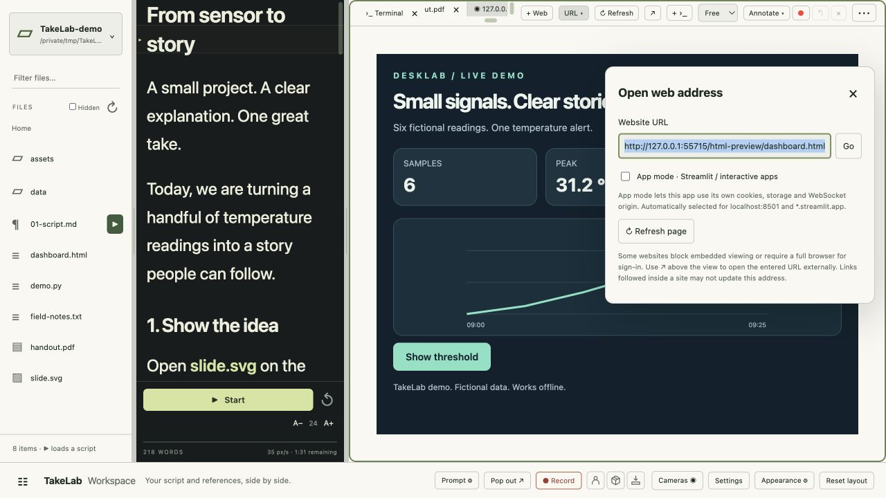

</details>

### 4. Point out what matters

Choose **Annotate → Laser**, **Pen** or **Highlighter**, then move or drag over the browse area. Use **Done** or **Escape** to return to clicking and scrolling. Undo and clear controls sit beside the tool button.

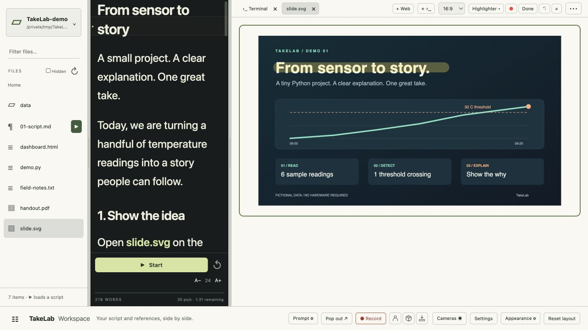

<details>
<summary>See annotation colors and thickness</summary>

Annotations are overlays for explaining on screen. They stay with the tab, do not follow scrolled content and reset on reload. They do not edit your source files.

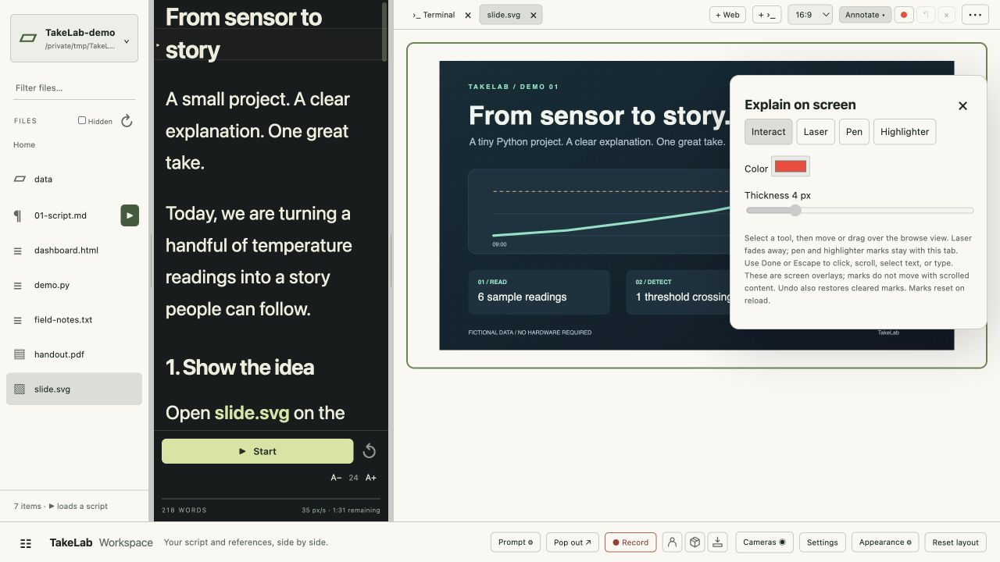

</details>

### 5. Set up your cameras and record

Open **Cameras**, choose a source for **Head**, **Project** or **Top**, and click **Start** for each view you need. Drag a camera by its title and resize its corner. Its maximize icon fills the browse area and restores the previous position/size on the next click. The small person, project and top-view icons in the workspace bar bring a camera to the front.

Then open **Record**, choose quality and audio, and click **Start recording**. In Chrome's share picker, choose **this TakeLab tab**. Keep it visible while recording.

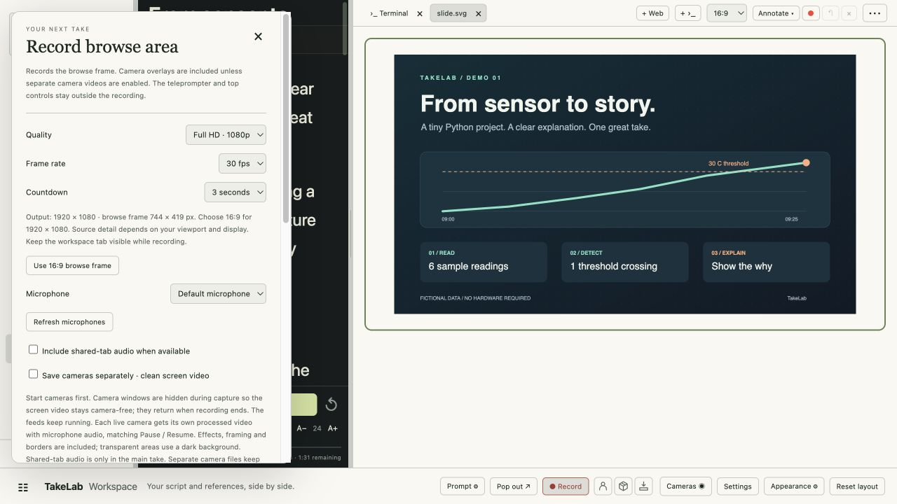

Start with **1080p / 30 fps** and a short test take. Use the prominent recording controls to **Pause / Resume**, **Stop** or **Mute mic**.

## Screens and settings

Expand a section for the controls you need. Long panels scroll; camera screenshots show settings with the feeds off.

<details>
<summary>Camera sources, framing and saved window positions</summary>

**Cameras:** select each device, choose **Mirror** and **Fill window / Fit whole frame**, then start its feed. Scroll down for Top and position controls.

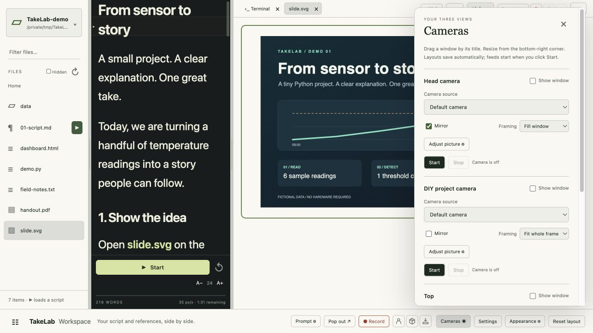

**Save positions** keeps the current arrangement; sizes and positions also save automatically. **Reset positions** restores the default layout.

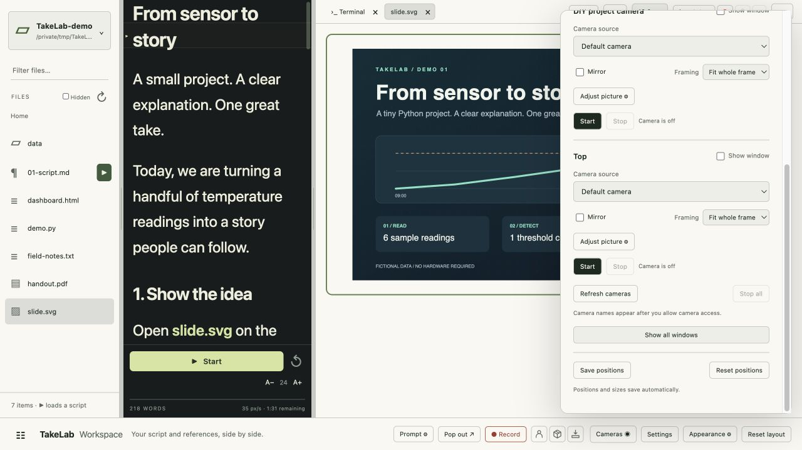

</details>

<details>
<summary>Camera lighting, framing, shape and auto-centering</summary>

Choose **Cameras → Adjust picture** for a camera. The **Adjust** dropdown switches which camera you are editing.

**Lighting:** brightness, contrast, saturation and warmth are software picture adjustments.

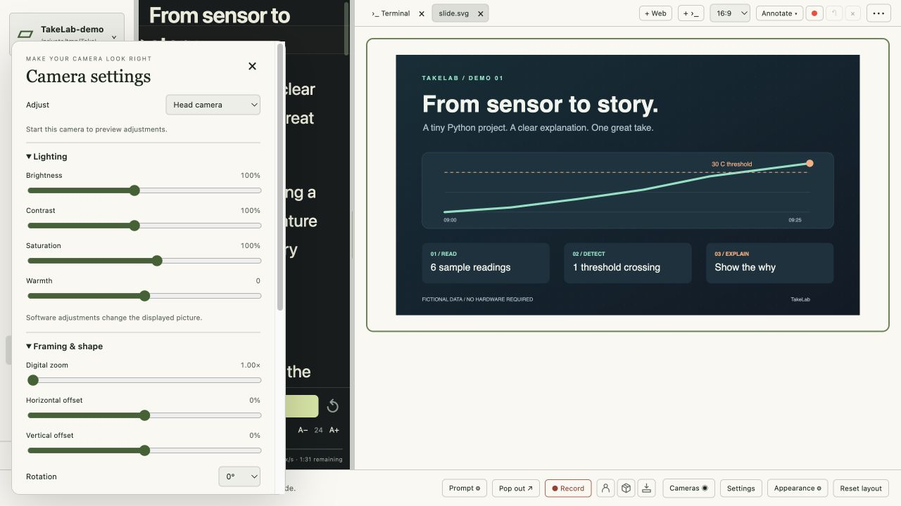

**Framing & shape:** zoom, horizontal/vertical offset, rotation, rectangle/circle shape and **Auto-center face**. Turn auto-centering off for a fixed project view.


</details>

<details>
<summary>Camera borders, touch-up and backgrounds</summary>

**Border:** choose color, thickness, rounding and solid/dashed/dotted style. Set thickness to zero for no border.

**Face touch-up:** subtle face softening needs a detected face.

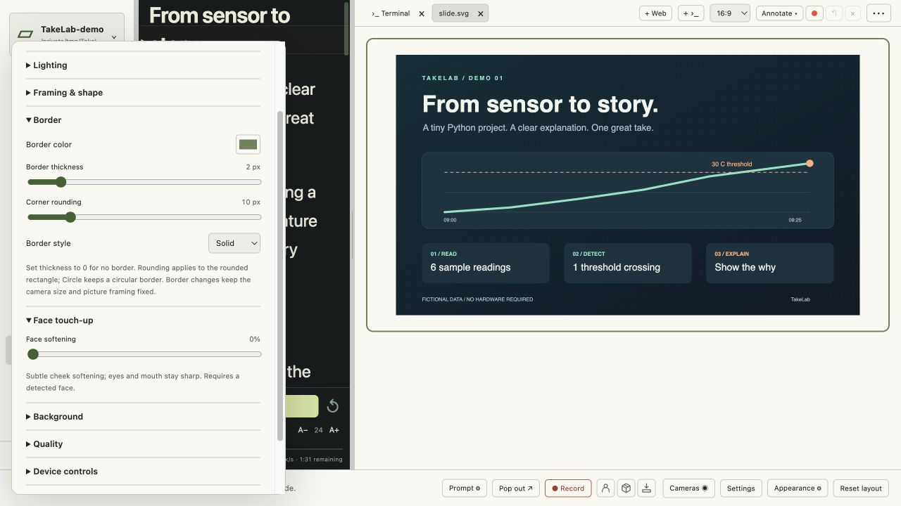

**Background:** blur, transparent removal, color replacement or a local image. Person segmentation is designed for people rather than project objects.


</details>

<details>
<summary>Camera resolution, device controls and presets</summary>

**Quality:** choose a resolution and capture frame rate. **Highest available · native** requests the highest resolution negotiated at the selected frame rate. Actual capture/output dimensions appear after the camera starts; the device and browser can provide less than requested.

Separate camera recordings use native capture detail independently of the small floating preview size. Multiple high-resolution feeds increase CPU, USB and storage use.

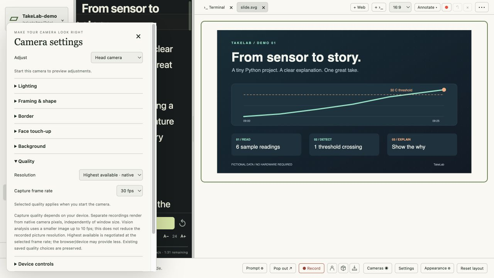

**Device controls:** available hardware controls appear only while a camera is running and depend on the device. **Saved presets** stores named picture/quality setups for each camera; window layout and source selection stay separate.

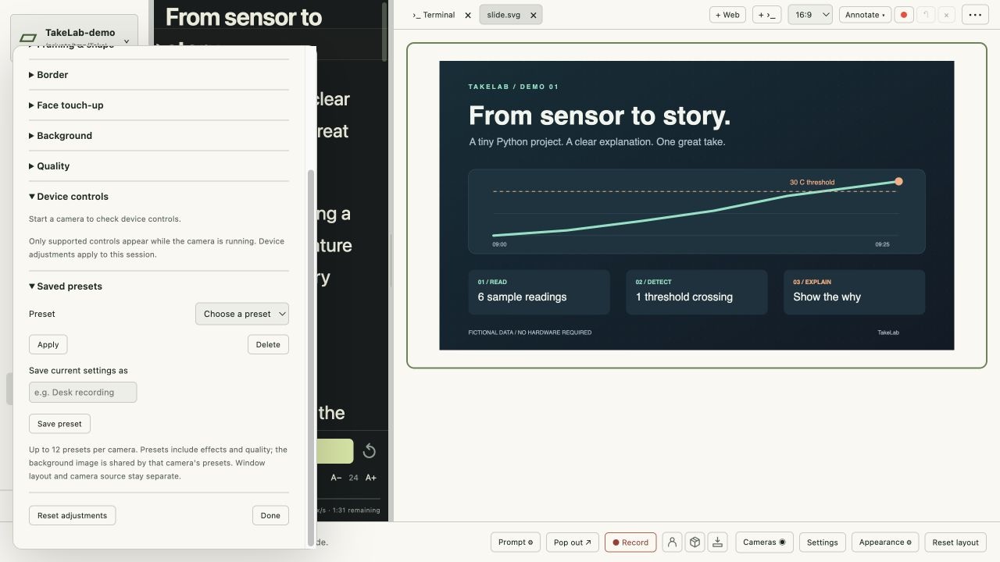

</details>

<details>
<summary>Workspace background, recording border and spacing</summary>

Open **Appearance** to choose the overall background, browse/terminal border color and thickness, rounded corners and inner spacing. Use the presets for a quick light or dark background.

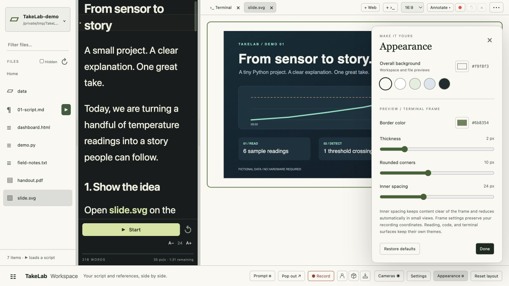

</details>

<details>
<summary>Save or restore all your settings</summary>

Open **Settings → Save settings backup** to download a JSON backup. **Load settings backup** restores preferences and reloads the app; finish recording first.

The backup includes camera layouts/effects/presets/background images, appearance, column widths, aspect ratio, annotations and recorder/prompt preferences. It does **not** include recordings, open files, browser permissions or session-only hardware adjustments. Cameras remain off until you start them.

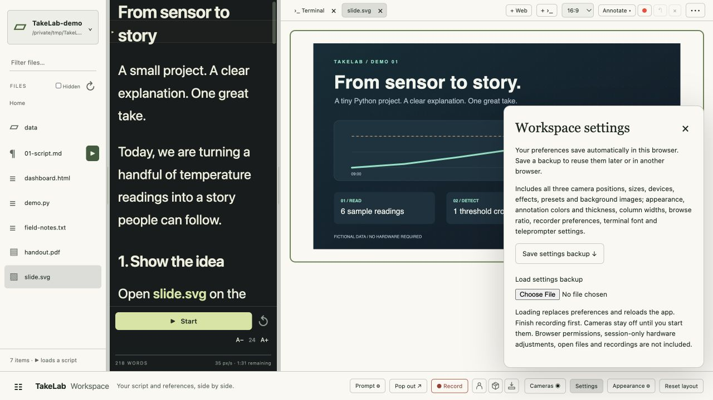

</details>

## Recording and downloads

| Option | Result |
| --- | --- |
| Separate cameras **off** | One browse-area video with visible camera overlays. |
| **Save cameras separately · clean screen video** | A clean screen video plus one processed video for each camera live at Start. Camera overlays hide during capture and return afterward. |
| Microphone | Recorded with the screen and separate camera files. |
| Optional shared-tab audio | Included in the screen recording when Chrome makes it available. |

Start cameras **before** starting the take. Pause/resume and mute apply across the outputs. Camera effects, framing and borders are included in separate camera files. The teleprompter and workspace controls stay outside the browse-frame recording.

After **Stop**, open **Record → Saved takes**, choose a take, review it and download it. For Camtasia, install FFmpeg separately:

```bash
brew install ffmpeg
```

Choose a **Camtasia** download to convert locally to constant-frame-rate H.264/AAC MP4. The original download remains available. FFmpeg is optional and is not bundled.

<details>
<summary>See saved takes, recovery and recording cleanup</summary>

The library is empty until your first take. Once a take is saved, selecting it reveals its preview and download/delete controls. **Delete selected recording** removes that take; **Delete all recordings** removes the library. Settings are preserved.

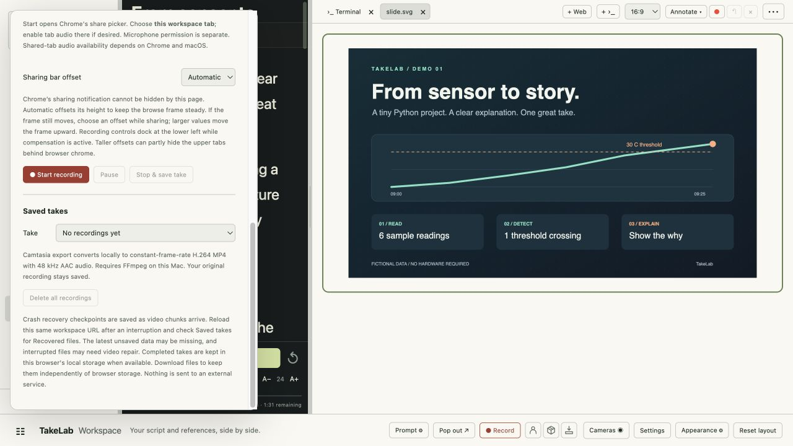

Chunk checkpoints reduce crash loss. Reopen the **same browser profile, address and port** after an interruption and check Saved takes for recovered files. Recovery is best-effort: the latest footage can be lost and interrupted media may need repair. Download important takes. Clearing site data removes browser-stored recordings and settings.

Chrome owns its sharing notification. **Sharing bar offset → Automatic** compensates for its height; choose a manual offset if needed. The app cannot hide Chrome's security UI.

</details>

[Watch the original short workspace tour](https://github.com/schogini/takelab/releases/download/v0.1.0/takelab-tour.mp4) · [Latest release](https://github.com/schogini/takelab/releases/latest)

## Scope and safety

- macOS/Chrome are the primary target. CI also runs backend tests on Linux; Windows and other browsers are not supported releases.
- Some websites block embedding or require sign-in in a full browser. Browser/OS policies control sharing notifications and popup chrome/placement.
- Camera resolution and frame rate depend on hardware, browser negotiation and system load. Test a short take on your own setup before an important session.
- This is a local tool with real shell and file-edit access. Use trusted folders and content, keep its loopback port private and do not expose it through a public tunnel or reverse proxy. See [SECURITY.md](SECURITY.md).

## More

[Full user guide](docs/USER_GUIDE.md) · [Standalone teleprompter](docs/TELEPROMPT.md) · [Contributing](CONTRIBUTING.md) · [Third-party notices](docs/THIRD_PARTY.md)

The compatibility launchers `workspace`, `start-both`, `browse` and `teleprompt` remain available. The original small examples remain in `examples/`; the visual walkthrough uses `demo/`. Existing settings and recording storage retain their original internal identifiers.

## License

TakeLab's original code is [MIT licensed](LICENSE), copyright © 2026 [Schogini Systems Private Limited](https://www.schogini.com). Bundled third-party libraries and models retain their own licenses and notices.
