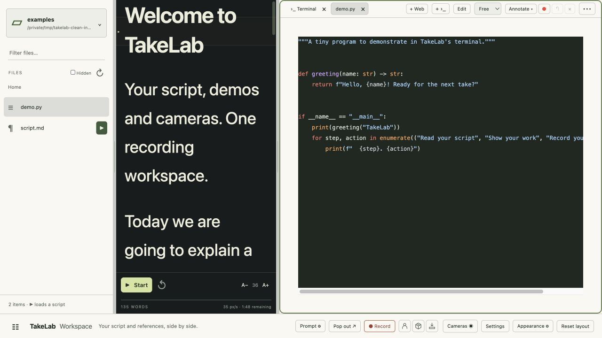
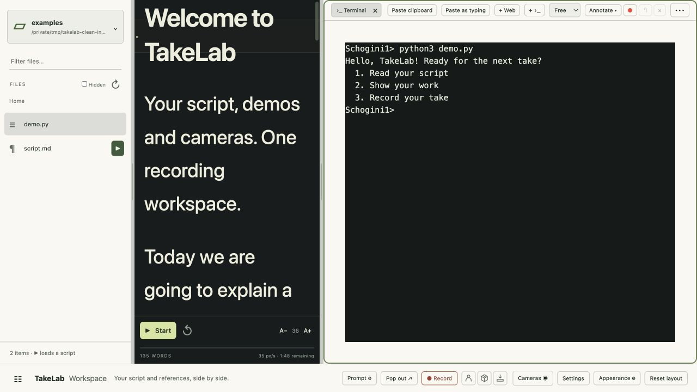
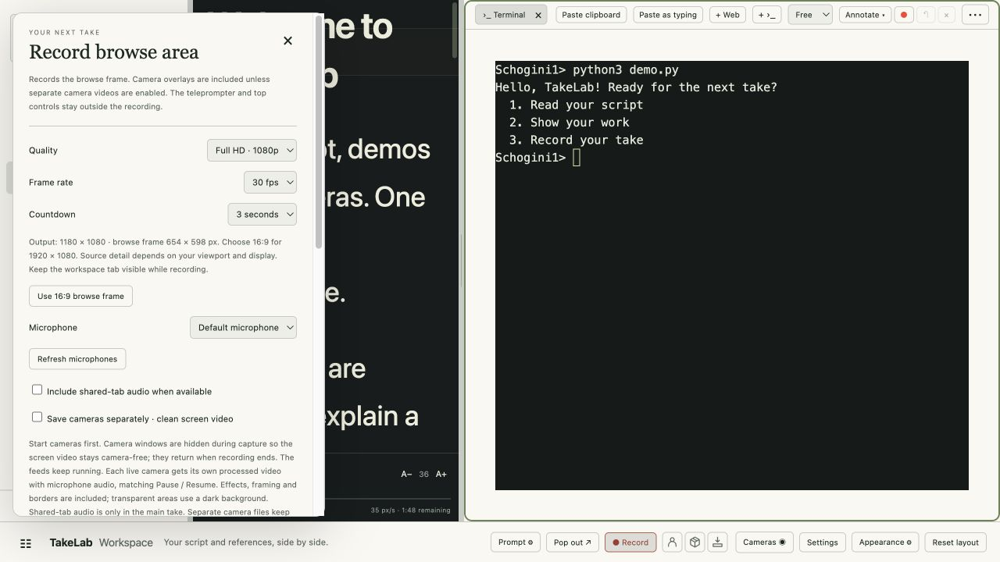

# TakeLab: A Local Recording Studio for Technical Creators

*Published on [Medium](https://medium.com/@schogini/takelab-a-local-recording-studio-for-technical-creators-2a634b9d2bb0).*

A technical recording often starts with a simple intention: explain a project clearly. Then the preparation grows. There is a script to read, a terminal to arrange, a browser page to demonstrate, and a camera view to position. Each piece needs to be ready when the explanation reaches it.

We built TakeLab around that workflow. It is a local recording workspace that brings a teleprompter, file previews, browser tabs, real terminals and up to three camera views into one browser window.

The project is MIT licensed, and the repository includes a complete demo you can use to try it. Here is how the pieces fit together, from opening a folder to downloading a take.



## Start your recording workspace from a folder

TakeLab runs a local Python server and opens in your browser. Its primary target is macOS with desktop Chrome. The core application uses Python's standard library, so there is no pip installation or frontend build step.

To try it:

```bash
git clone https://github.com/schogini/takelab.git
cd takelab
./takelab ./demo
```

The included demo is a small, fictional sensor project. It contains a narration script, a Python program, CSV readings, an interactive HTML dashboard, a slide, a PDF handout and editable notes. No hardware or API credentials are needed to run it.

You can also point TakeLab at your own project folder. Files appear in a collapsible list, and the terminal starts in the browsed folder. The working directory you are explaining becomes the starting point for the presentation.

## Keep the script steady while the demonstration changes

The teleprompter and browse area are independent. A Markdown file can remain pinned as your script while you switch the reference from code to a terminal or a web page.

Text size, scrolling speed, line spacing and reading width are adjustable. Manual scrolling pauses automatic movement; a click in the reading area resumes it. A compact pop-out can bring the script closer to your camera, with controls along the bottom. Exact placement and window chrome remain subject to browser and operating-system policies.

That independence matters during a technical explanation. You can keep your place in the narration as you move through the evidence on screen.

The browse area supports formatted Markdown, images, highlighted code, text files and PDFs. HTML files have Browse and Source modes. A local editor lets you update text and scripts, with saves written to the original file.

URL tabs let you demonstrate web apps beside your notes. There is a refresh control and an app mode for Streamlit and other interactive pages. Some sites prohibit embedded viewing; those still need a regular browser tab.

## Show the code, run it, then explain the result

The sample Python program reads six invented temperature measurements and checks an alert threshold. In the demo-folder terminal, run:

```bash
python3 demo.py
python3 demo.py --limit 28
python3 demo.py --json
```

The first command reports six samples, an average of 26.5 C and a peak of 31.2 C. One reading exceeds the default 30 C limit. Lowering the threshold to 28 C produces two alerts.

That small comparison gives a presenter something concrete to explain: the data remains fixed while one parameter changes the result.



The terminal is a real shell. Multiple tabs can hold different parts of a demonstration. Paste as typing lets you review commands and choose a natural pace; a direct clipboard button types without opening the review panel. By default, the presenter supplies the final Enter.

The HTML dashboard provides a visual companion. Its Show threshold button reveals a line on the chart. It uses a fixed copy of the fictional data, so it remains an independent HTML example rather than a live view of the CSV.

Laser, pen and highlighter tools help guide attention. Their marks are screen overlays: they leave the source file unchanged, remain associated with the tab and reset on reload. Aspect-ratio and appearance controls help prepare a consistent browse frame before recording.

## Give cameras a role, then choose your outputs

TakeLab has three camera roles: Head, Project and Top. They can represent the presenter, a device or experiment, and an overhead desk view. Each camera view can be moved, resized, brought to the front, or expanded to fill the browse area and restored afterward.

Picture settings include software lighting adjustments, framing, rotation, shapes and borders. Presenter-oriented options include face auto-centering, subtle softening and background effects. A fixed project view may work better with those person-focused effects switched off.

The quality controls can request the highest available native resolution at a selected frame rate. The actual result depends on the camera, browser and hardware load; the interface reports capture and output dimensions after the camera starts. A small floating preview does not determine the resolution of a separate camera recording.

There are two recording workflows. One combines the browse area with its visible camera overlays. The other produces a clean screen video and separate processed files for the cameras that were live at Start. Separate camera files include microphone audio; optional shared-tab audio belongs to the screen recording.



During a take, prominent controls provide pause, resume, stop and microphone mute. Completed takes can be reviewed and downloaded from Saved takes. An optional local FFmpeg conversion creates constant-frame-rate H.264/AAC MP4 files for Camtasia editing while keeping the original download available.

## Keep a repeatable setup—and downloaded copies of your takes

A settings backup preserves the arrangement and preferences you have prepared: camera layouts and effects, appearance, column widths, aspect ratio, recorder options and teleprompter settings. It does not include recordings, browser permissions or session-only hardware adjustments.

Recording chunks are checkpointed as they arrive. This can help recover an interrupted session when you return to the same browser profile and local address, including the port. Recovery is best-effort: the latest footage can be lost, and an interrupted media file may need repair. Important takes should be downloaded independently of browser storage.

TakeLab also has real shell and local file-edit access. Use trusted folders and content, and keep its loopback service private. It is intended as a local creator tool rather than a public multi-user service.

If you record coding lessons, project demonstrations or technical walkthroughs, start with the included demo. Read the script, run the commands, show the result, and make a short test take with your own cameras and microphone. The [visual README](https://github.com/schogini/takelab#readme) walks through the main screens and settings. You can [explore TakeLab on GitHub](https://github.com/schogini/takelab), report a reproducible issue, or suggest a workflow improvement. If it earns a place in your recording setup, a star helps other creators discover it.

*TakeLab is MIT licensed. Copyright © 2026 [Schogini Systems Private Limited](https://www.schogini.com).*
